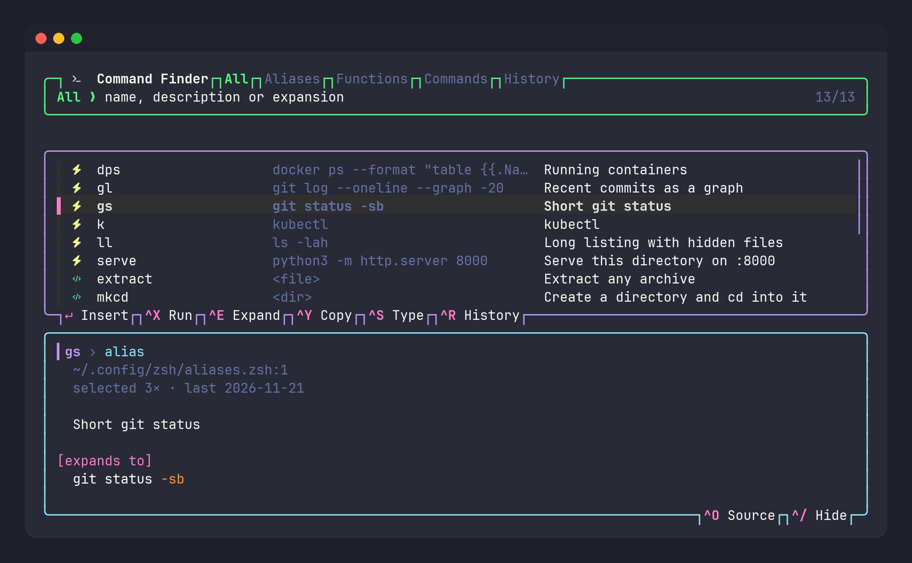

# command-finder

English | [简体中文](README.zh-CN.md)

A zsh plugin that turns your own aliases, functions and documented commands into a searchable fzf picker. Press `Ctrl-G`, type a few letters, and insert, run or copy the command.



- **Aliases** defined in your config files, with their trailing comment as the description
- **Functions** with a `# @desc:` / `# @usage:` comment above them
- **Catalog lines**: comment lines such as `# git log --oneline -20   # Show the last 20 commits`, for subcommands and common invocations
- **History**: what you pick is remembered and ranked by frecency

## Requirements

- zsh 5.8+
- [fzf](https://github.com/junegunn/fzf) 0.58+
- Optional: [bat](https://github.com/sharkdp/bat) (or Debian's `batcat`) for highlighted previews, a [Nerd Font](https://www.nerdfonts.com/) for the type icons

Without fzf the plugin loads nothing and says so when the shell starts; without bat the preview is plain text.

Run `cf-doctor` to check everything at once: zsh and fzf versions, bat, the clipboard and editor it will use, each `CF_PATHS` entry and how many entries it found, whether the key still opens the picker, and the history file. It is defined even when fzf is missing, and exits non-zero when something required is.

## Install

**Homebrew**

```sh
brew install iskerwin/tap/command-finder
echo 'source "$(brew --prefix)/share/command-finder/command-finder.plugin.zsh"' >> ~/.zshrc
```

**[zap](https://github.com/zap-zsh/zap)**

```zsh
plug "iskerwin/command-finder"
```

**Manual**

```sh
git clone https://github.com/iskerwin/command-finder ~/.local/share/command-finder
echo 'source ~/.local/share/command-finder/command-finder.plugin.zsh' >> ~/.zshrc
```

Any plugin manager that sources `*.plugin.zsh` (antidote, zinit, sheldon, Oh My Zsh custom plugins) works the same way.

### Load order

- Set the `CF_*` variables (below) first.
- Choose your keymap (`bindkey -v` / `-e`) before loading it: `Ctrl-G` is bound in the current keymap.
- Load it before plugins that wrap widgets (zsh-syntax-highlighting, fast-syntax-highlighting), so they cover `Ctrl-G` too.
- With zsh-remote, load it after zsh-remote and add `$ZSH_REMOTE_DIR` to `CF_PATHS` to list its commands. zsh-ui can load anywhere.

```zsh
plug "iskerwin/zsh-ui"                      # 1. anywhere; first is simplest
plug "zap-zsh/supercharge"                  # 2. compinit (or your own compinit call)
plug "iskerwin/zsh-remote"                  # 3. after compinit
CF_PATHS=( ~/.zshrc ~/.config/zsh ${ZSH_REMOTE_DIR-} )
plug "iskerwin/command-finder"              # 4. after zsh-remote, so CF_PATHS can list its commands
plug "zsh-users/zsh-syntax-highlighting"    # 5. widget-wrapping plugins last
```

## Usage

| Key | Action |
|---|---|
| `Ctrl-G` | Open the picker (also `command_finder`; many people add `alias cf=command_finder`) |
| `Enter` | Insert into the command line |
| `Ctrl-X` | Run it |
| `Ctrl-E` | Insert an alias's expansion instead of its name |
| `Ctrl-Y` | Copy (an alias copies its expansion) |
| `Ctrl-S` | Cycle the views: All → Aliases → Functions → Commands |
| `Ctrl-R` | Toggle the History view |
| `Ctrl-O` | Open the definition in `$VISUAL` / `$EDITOR` |
| `Ctrl-/` | Toggle the preview |

The All view is grouped alias → function → command and sorted by name within each group. The History view is sorted by frecency.

`cf-doctor` checks the setup (see [Requirements](#requirements)).

`cf::group <prefix> [keywords...]` opens the picker with only the `<prefix>-*` commands, which makes an easy entry point for a family of functions:

```zsh
# @desc: Network tools
# @usage: net [keywords...]
net() { cf::group net "$@"; }
```

## Writing entries

```zsh
alias gl='git log --oneline -20'          # Show the last 20 commits

# @desc: Create a directory and cd into it
# @usage: mkcd <dir>
mkcd() { mkdir -p -- "$1" && cd -- "$1"; }

# docker compose logs -f <service>         # Follow a service's logs
```

Functions starting with `_` or containing `::` are treated as internal and never listed. Catalog lines need at least two spaces before the second `#`; the inserted text stops at the first ` <` or ` [` placeholder.

## Configuration

Set these before sourcing the plugin.

| Variable | Default | Meaning |
|---|---|---|
| `CF_PATHS` | `~/.zshrc` `~/.config/zsh` | Files and directories to scan (directories: every `*.zsh` below them); `cf-doctor` is always listed |
| `CF_FUNCTION_ALL` | empty | awk regex of file paths whose public functions are listed even without `@desc` |
| `CF_BINDKEY` | `^G` | Key that opens the picker; empty binds nothing |
| `CF_HISTORY_MAX` | `1000` | Selections kept in `${XDG_STATE_HOME:-~/.local/state}/command-finder/history` |
| `CF_HISTORY_ONLY_MAX` | `50` | History entries shown that match no alias, function or catalog line |

Install [zsh-ui](https://github.com/iskerwin/zsh-ui) to give command-finder the same TUI-style look as your other tools (as in the screenshot); without it, command-finder uses a plain built-in look. Copying uses `clip-copy` when available, then `pbcopy`, `wl-copy`, `xclip`, `xsel`, and finally OSC 52.

## Development

```sh
zsh -f tests.zsh
```

CI also checks that `lib/ui-fallback.zsh` is an unchanged copy of the latest [zsh-ui](https://github.com/iskerwin/zsh-ui) release.

## License

[MIT](LICENSE)
