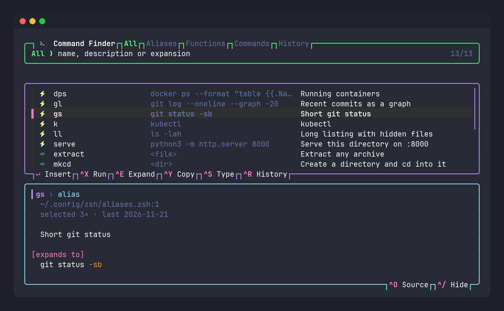

# command-finder

[English](README.md) | 简体中文

一个 zsh 插件，把你自己的 alias、函数和写了说明的命令变成可搜索的 fzf 选择器。按 `Ctrl-G`，输入几个字母，就能插入、执行或复制命令。



- **Alias**：配置文件中定义的 alias，行尾注释作为说明
- **函数**：上方带 `# @desc:` / `# @usage:` 注释的函数
- **目录行**：形如 `# git log --oneline -20   # Show the last 20 commits` 的注释行，用来记录子命令和常用写法
- **历史**：选过的命令会被记住，按热度（frecency）排序

## 依赖

- zsh 5.8+
- [fzf](https://github.com/junegunn/fzf) 0.58+
- 可选：[bat](https://github.com/sharkdp/bat)（或 Debian 的 `batcat`）用于高亮预览，[Nerd Font](https://www.nerdfonts.com/) 用于类型图标

没有 fzf 时插件什么都不加载，并在 shell 启动时说明；没有 bat 时预览为纯文本。

运行 `cf-doctor` 一次检查全部：zsh 和 fzf 版本、bat、将使用的剪贴板和编辑器、`CF_PATHS` 每一项及找到的条目数、快捷键是否仍能打开选择器，以及历史文件。即使缺少 fzf 它也会被定义；缺少必需项时以非零状态退出。

## 安装

**Homebrew**

```sh
brew install iskerwin/tap/command-finder
echo 'source "$(brew --prefix)/share/command-finder/command-finder.plugin.zsh"' >> ~/.zshrc
```

**[zap](https://github.com/zap-zsh/zap)**

```zsh
plug "iskerwin/command-finder"
```

**手动**

```sh
git clone https://github.com/iskerwin/command-finder ~/.local/share/command-finder
echo 'source ~/.local/share/command-finder/command-finder.plugin.zsh' >> ~/.zshrc
```

任何会 source `*.plugin.zsh` 的插件管理器（antidote、zinit、sheldon、Oh My Zsh 自定义插件）用法相同。

### 加载顺序

- 先设置 `CF_*` 变量（见下文）。
- 加载前先选好键位模式（`bindkey -v` / `-e`）：`Ctrl-G` 绑定在当前键位模式中。
- 在会包装 widget 的插件（zsh-syntax-highlighting、fast-syntax-highlighting）之前加载，让它们也覆盖 `Ctrl-G`。
- 与 zsh-remote 一起用时，在 zsh-remote 之后加载，并把 `$ZSH_REMOTE_DIR` 加进 `CF_PATHS` 以列出它的命令。zsh-ui 放在哪里都行。

```zsh
plug "iskerwin/zsh-ui"                      # 1. 任意位置；放最前最简单
plug "zap-zsh/supercharge"                  # 2. compinit（或你自己的 compinit 调用）
plug "iskerwin/zsh-remote"                  # 3. 在 compinit 之后
CF_PATHS=( ~/.zshrc ~/.config/zsh ${ZSH_REMOTE_DIR-} )
plug "iskerwin/command-finder"              # 4. 在 zsh-remote 之后，CF_PATHS 才能列出它的命令
plug "zsh-users/zsh-syntax-highlighting"    # 5. 包装 widget 的插件放最后
```

## 使用

| 按键 | 作用 |
|---|---|
| `Ctrl-G` | 打开选择器（也可以用 `command_finder`；很多人加上 `alias cf=command_finder`） |
| `Enter` | 插入到命令行 |
| `Ctrl-X` | 直接执行 |
| `Ctrl-E` | 插入 alias 展开后的内容而不是名字 |
| `Ctrl-Y` | 复制（alias 复制展开后的内容） |
| `Ctrl-S` | 切换视图：All → Aliases → Functions → Commands |
| `Ctrl-R` | 切换到 History 视图 |
| `Ctrl-O` | 在 `$VISUAL` / `$EDITOR` 中打开定义处 |
| `Ctrl-/` | 显示或隐藏预览 |

All 视图按 alias → 函数 → 命令分组，组内按名字排序。History 视图按热度排序。

`cf-doctor` 检查环境（见[依赖](#依赖)）。

`cf::group <前缀> [关键词...]` 打开只含 `<前缀>-*` 命令的选择器，很适合作为一组函数的入口：

```zsh
# @desc: Network tools
# @usage: net [keywords...]
net() { cf::group net "$@"; }
```

## 编写条目

```zsh
alias gl='git log --oneline -20'          # Show the last 20 commits

# @desc: Create a directory and cd into it
# @usage: mkcd <dir>
mkcd() { mkdir -p -- "$1" && cd -- "$1"; }

# docker compose logs -f <service>         # Follow a service's logs
```

以 `_` 开头或包含 `::` 的函数视为内部函数，从不列出。目录行在第二个 `#` 前至少要有两个空格；插入的文本到第一个 ` <` 或 ` [` 占位符为止。

## 配置

在 source 插件之前设置。

| 变量 | 默认值 | 含义 |
|---|---|---|
| `CF_PATHS` | `~/.zshrc` `~/.config/zsh` | 要扫描的文件和目录（目录：其下所有 `*.zsh`）；`cf-doctor` 总会列出 |
| `CF_FUNCTION_ALL` | 空 | 文件路径的 awk 正则，匹配文件中的公开函数即使没有 `@desc` 也会列出 |
| `CF_BINDKEY` | `^G` | 打开选择器的按键；为空则不绑定 |
| `CF_HISTORY_MAX` | `1000` | 在 `${XDG_STATE_HOME:-~/.local/state}/command-finder/history` 中保留的选择记录数 |
| `CF_HISTORY_ONLY_MAX` | `50` | 不匹配任何 alias、函数或目录行的历史条目最多显示多少条 |

安装 [zsh-ui](https://github.com/iskerwin/zsh-ui)，command-finder 就会和你的其他工具一样使用 btop 风格（如截图所示）；没有它时使用朴素的内置样式。复制时依次尝试 `clip-copy`、`pbcopy`、`wl-copy`、`xclip`、`xsel`，最后用 OSC 52。

## 开发

```sh
zsh -f tests.zsh
```

## 许可证

[MIT](LICENSE)
